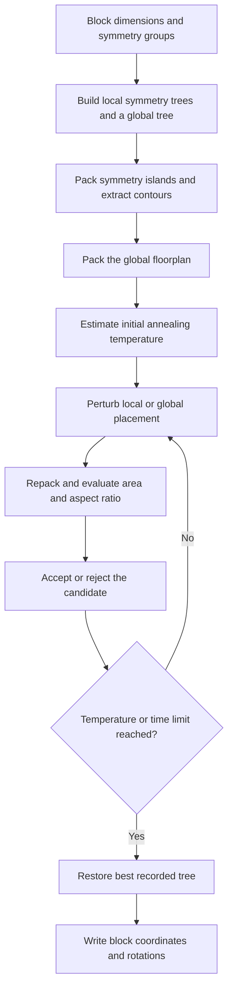

# Symmetry-Constrained Floorplanning

A physical design project that combines symmetry-island modeling, hierarchical B*-tree packing, and simulated annealing to place rectangular circuit blocks under symmetry constraints. The floorplanner reads block dimensions and symmetry groups, searches for a compact placement, and outputs block coordinates and rotation flags.

## My Contribution

I implemented the floorplanning pipeline in [`main.cpp`](main.cpp), including input parsing, floorplan representations, packing, optimization, and output generation. The implementation includes:

- **Symmetry-island modeling:** local trees represent paired and self-symmetric blocks within each group, with mirrored placement around a shared horizontal or vertical axis.
- **Hierarchical B*-tree packing:** a global tree combines ordinary blocks with symmetry islands. Piecewise top and bottom contours represent island geometry during packing.
- **Contour maintenance:** linked-list contours track occupied heights for both local and global placement.
- **Simulated annealing:** a warm-up phase estimates the initial temperature, followed by local and global perturbations with probabilistic acceptance of uphill moves.
- **Constraint-aware perturbations:** block rotation, node swapping, node reinsertion, and symmetry-axis changes explore alternative placements. Local tree checks keep self-symmetric blocks on the branch associated with the symmetry axis.
- **Area and shape optimization:** a bounding-box area objective includes a soft aspect-ratio penalty, with the best recorded tree retained for output.

The project applies tree data structures, geometric packing, and stochastic optimization to an electronic design automation (EDA) problem. Its symmetry-island and hierarchical tree approach is based on *Analog Placement Based on Symmetry-Island Formulation*, cited below; the code is my own course implementation.

## Floorplanning Pipeline



Each symmetry island stores one representative per symmetric pair, along with any self-symmetric blocks. Packing reconstructs the paired blocks by reflection and places self-symmetric blocks on the group's axis. The global representation uses the island's contours to pack it together with nonsymmetric blocks.

The annealing search favors local island changes while also exploring global changes to ordinary blocks. Rejected candidates restore the previous tree state; accepted candidates update the best recorded solution when their cost improves.

## Build and Run

### Requirements

- A C++14 compiler, such as `g++`
- GNU Make
- Linux or WSL on x86-64 for the supplied `checker` executable
- Bash if using `run.sh`

Run the following commands from the project's root directory in a Linux or WSL shell.

### Build

```bash
make
```

The Makefile builds `Lab2` with C++14, `-O3`, and `-Wall`. Use `make clean` before rebuilding if an existing executable was built on another machine.

### Generate a floorplan

```bash
./Lab2 cases/block_30.in cases/block_30.out
```

The command-line interface takes an input file and an output path:

```text
./Lab2 <input_file> <output_file>
```

Each output line contains a block name, its lower-left coordinates, and a rotation flag:

```text
<block_name> <x> <y> <rotated>
```

The rotation flag is `0` for the original orientation and `1` for a 90-degree rotation. Coordinates are written in the input's units.

### Validate the output

```bash
chmod +x checker
./checker cases/block_30.in cases/block_30.out
```

Use the course-provided checker to validate generated solutions. The repository includes the checker as a prebuilt Linux x86-64 executable.

To build and process the available cases with the batch script:

```bash
bash run.sh
```

The script cleans and rebuilds `Lab2`, writes `.out` files into `cases/`, and invokes the checker after each successful run. Existing output files with matching names are overwritten.

The included inputs are `block_30.in`, `block_100.in`, and `block_500.in`.

## Evaluation

The assignment evaluates correctness, solution quality, and runtime. The objective is to minimize the chip bounding-box area while satisfying symmetry constraints and avoiding block overlaps.

| Metric | Meaning |
| --- | --- |
| Bounding-box area | Width multiplied by height of the packed floorplan |
| Placement validity | Whether the generated output satisfies the problem constraints, checked with `checker` |
| Runtime | Elapsed time to generate a floorplan |

## Implementation Notes

- **Aspect-ratio penalty:** the annealing search discourages elongated layouts through an internal search preference. For area `A` and aspect ratio `r` (bounding-box width divided by height), the internal cost is `A + floor(0.2 * A * p(r))`, where:

  ```text
  p(r) = 0.5 - r    if r < 0.5
         0          if 0.5 <= r <= 2.0
         r - 2.0    if r > 2.0
  ```

  The aspect-ratio range is a soft preference, not a hard placement constraint.

- **Coordinate precision:** block dimensions are doubled internally, allowing half-unit positions to be represented with integers. Output coordinates are divided by two.
- **Annealing schedule:** 100 warm-up perturbations estimate uphill cost changes. The initial temperature targets a 0.95 acceptance probability for the estimated average uphill change; the search uses 20,000 iterations per temperature, a cooling factor of 0.9, and a stopping temperature of 0.1.
- **Runtime control:** the solver checks a 3,300-second elapsed-time threshold during annealing. Checks occur between work units, so this is not a hard end-to-end runtime bound.
- **Reproducibility:** the pseudorandom generator uses a fixed seed of `42`. When the elapsed-time cutoff is reached, hardware speed can affect how much of the search completes.

## Source Guide and Attribution

| File or component | Role and origin |
| --- | --- |
| [`main.cpp`](main.cpp) | My implementation of parsing, symmetry modeling, packing, simulated annealing, and output generation |
| [`checker`](checker) | Course-provided solution checker, distributed as a prebuilt executable |
| [`Makefile`](Makefile) | C++14 build configuration |
| [`run.sh`](run.sh) | Batch execution and validation script |
| [`cases/`](cases/) | Input examples with 30, 100, and 500 blocks |

The course-provided checker is credited separately from my implementation in `main.cpp`.

### Reference

P.-H. Lin, Y.-W. Chang, and S.-C. Lin, "Analog Placement Based on Symmetry-Island Formulation," *IEEE Transactions on Computer-Aided Design of Integrated Circuits and Systems*, vol. 28, no. 6, pp. 791-804, June 2009. [DOI: 10.1109/TCAD.2009.2017433](https://doi.org/10.1109/TCAD.2009.2017433).
